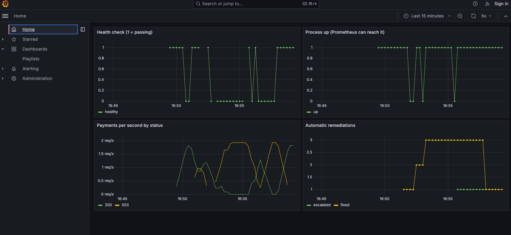

# self-healing-lab

A laptop-sized version of the self-healing operations I ran in production banking: detection, a ticket, automated remediation, verification, and escalation to a human when automation isn't enough.

## How it works

1. A payments service exposes Prometheus metrics; fake customers send it traffic.
2. Prometheus fires `AppUnhealthy` when the health metric stays at 0 for 15 seconds, or `AppDown` when the process stops answering.
3. Alertmanager posts the alert to the remediator.
4. The remediator opens a GitHub Issue (the ServiceNow stand-in) and runs an Ansible playbook (ansible/restart_service.yml) that finds the service's container through the Docker API, restarts it and waits until the health check passes. Ansible's run report goes into the issue as evidence, and the issue is closed with the recovery time.
5. More than 3 restarts in 10 minutes means automation is masking a real problem: it stops and opens a `needs-human` issue instead.
6. Grafana shows health, traffic and remediations on one dashboard.

Typical recovery: about 40 seconds, no human.

## Run it

    cp .env.example .env        # optional: add a GitHub token to get real issues
    docker compose up --build -d
    bash scripts/demo.sh break  # or: bash scripts/demo.sh crash

Grafana: http://localhost:3000 · Prometheus: http://localhost:9090 · Alertmanager: http://localhost:9093

### Example

## Design choices

- Only alerts labelled `remediation: restart` are acted on; symptoms like a high error rate are shown, never auto-fixed.
- `for:` durations stop one bad reading from triggering a restart.
- The rate limit turns a restart loop into an escalation.
- Mounting the Docker socket is acceptable in a lab; in production the remediator would call the platform's API (OpenShift, Kubernetes) with a narrowly scoped service account.
- The fix is a runbook as code: one Ansible playbook, readable and reviewable, with variables (-e service=... -e health_url=...) so it works for any service. It needs only ansible-core: it calls Docker's API through the socket with the built-in uri module. You can run it by hand: ansible-playbook ansible/restart_service.yml -e health_url=http://localhost:8000/health.

## Tests

`pytest -v` covers the alert filter, the rate limiter, the ticket text, the Ansible command and the app's failure mode. CI also runs `ansible-lint` (production profile), the official `promtool` and `amtool` checkers, builds every image, and runs a chaos test: it breaks the app on GitHub's machine and fails unless the Ansible playbook heals it.
